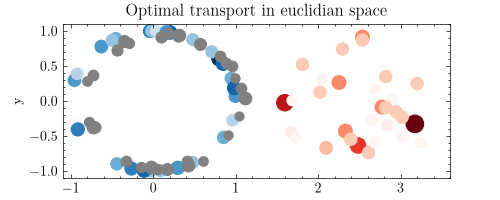

# Computational optimal transport

## Discrete optimal transport
- [Euclidian space](discrete/euclidian.ipynb)
- []Optimal transport between gaussians in R
- [] Optimal transport between gaussians in R2
- [] Linear program
- [] Minimum cost bipartite matching
- [] Relaxing the Monge formulation
- [] Sinkhorn algorithm and Birkhoff-Von Neuman decomposition
- [] Grayscale histogram equalization
- [] Image colour transfer

## Semi-discrete optimal transport
- [] Projective gradient ascent
- [] Nesterov smoothing

## Continuous optimal transport
- [] Continuous optimal transport between gaussians

## Wasserstein
- [] Wasserstein distance
- [] Wasserstein geodesic and barycenter]

## Regularization
- [] Entropic regularization

## Unbalanced optimal transport

## Partial optimal transport

## Statistical learning and ML
- [] Optimal transport and statistical learning
- [] Background density estimation
- [] Density estimation with continuous normalizing flows
- [] Classification
- [] Wasserstein Generative Adverserial Network

## PDEs

**Optimal transport and continuity equations**
- [] Gradient flows
- [] Benamou-Brenier formulation
- [] Continuity equation and mass conservation
- [] Displacement interpolation
- [] Optimal velocity fields and potential flows
- [] Hamilton-Jacobi equations and duality
- [] Weak solutions and measure-valued solutions

**Wasserstein gradient flows and nonlinear diffusion equations**
- [] Wasserstein gradient flows
- [] Linear diffusion equation
- [] Non-linear diffusion equation
- [] Jordan-Kinderlehrer-Otto (JKO) scheme
- [] Entropy methods and dissipation inequalities
- [] Porous medium and fast diffusion equations
- [] Nonlinear Fokker-Planck equations
- [] Long-time asymptotics and convergence to equilibrium
- [] Geodesic convexity and functional inequalities

**Monge-Ampère equations and elliptic PDEs**
- [] Solutions to Monge-Ampère equations
- [] Regularity of optimal transport maps
- [] Caffarelli's regularity theory
- [] Aleksandrov solutions and viscosity solutions
- [] Boundary regularity
- [] Transport on Remanian manifolds
- [] Curvature conditions and geometric inequalities
- [] Stability of solutions under perturbation of densities

**Fluid mechanics**
- [] Incompressible Euler equations
- [] Generalized incompressible flows
- [] Arnold's geometric interpretation of Euler equations
- [] Least-action principles
- [] Semi-geostrophic equations
- [] Congested transport and density constraints
- [] Optimal transport with prescribed divergence

**Mean field games**
- [] Variational formulation of mean field games
- [] Mean field limits
- [] Population planning
- [] Congestion models
- [] Weak solutions
- [] Numerical methods for coupled Hamilton-Jacobi and Fokker-Planck equations

**Kinetic equations**
- [] Boltzmann equation
- [] Vlasov-Poison equation
- [] Vlasov-Fokker-Planck equation
- [] Kinetic Fokker-Planck equations
- [] Landau equation
- [] Interacting particle systems

**Geometry and curvature**
- [] Ricci curvature and Wasserstein geodesics
- [] Otto calculus and formal Riemaninan geometry
- [] Displacement convexity
- [] Bakry-Émery curvature
- [] Metric measure spaces
- [] Synthetic Ricci curvature bounds
- [] Heat flow and entropy dissipation

**Others**
- [] Wasserstein-Fisher-Rao geometry
- [] Nonlocal gradient flows
- [] Wasserstein splines

## Shrödinger bridges

# Optimal transport on graphs

